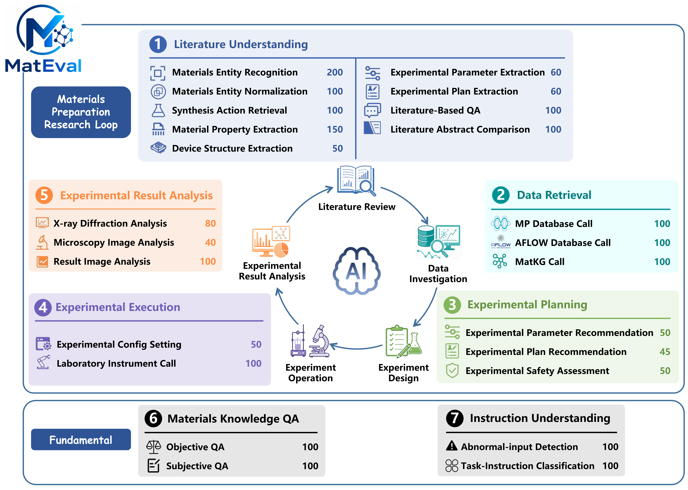

# MatEval: A Benchmark for LLMs from Knowing to Doing across the Materials Preparation Research Loop

<div align="center">


[](https://www.python.org/downloads/)
[](LICENSE)

[English](README.md) | [中文](README_zh.md)
</div>


## 📖 Introduction

Large language models (LLMs) hold promise for materials science, yet existing benchmarks fall short of covering the full research loop of real-world materials preparation. To bridge this gap, we present MatEval, a comprehensive benchmark assessing LLMs across the materials preparation research loop: from foundational competencies (Materials Knowledge QA and Instruction Understanding) through five stages (Literature Understanding, Data Retrieval, Experimental Planning, Experimental Execution, and Experimental Result Analysis). MatEval contains 24 tasks with a total of 2,135 expert-curated instances and stage-specific scoring protocols for evaluating model capabilities from knowing to doing. We evaluate 24 general-purpose and science-specialized LLMs. Results reveal systematic performance differences across stages, with no model performing consistently across the full loop. Notably, science-specialized models show no consistent advantage over general-purpose models. MatEval extends evaluation beyond materials question answering to stage-specific research artifacts, revealing uneven model performance across the materials preparation research loop.

## ✨ Key Features

- **Comprehensive Coverage**: 24 tasks covering the entire materials research workflow — literature survey, data investigation, experimental design, experimental operation, and experimental results analysis.
- **Multimodal Evaluation**: 22 text tasks and 2 vision tasks (microscopy image analysis, result image analysis).
- **Diverse Metrics**: ACC, F1, SCORE (including LLM-as-a-Judge), and MAE, each tailored to the task type.

📝 **Submit your model for evaluation**: [MatEval Model Evaluation Submission Form](https://forms.gle/3s4nisjc71j3J6Xc9)


## 📊 Evaluation Tasks

| #  | Task | Description |
| :-: | :-- | :-- |
| 1  | **Materials Domain Objective QA** | Objective knowledge QA in the materials domain (multiple-choice, true/false). |
| 2  | **Materials Domain Subjective QA** | Subjective knowledge QA in the materials domain. |
| 3  | **Abnormal Input Detection** | Perform abnormal detection on input instructions. |
| 4  | **Task-Instruction Classification** | Identify and classify the true intent of a user instruction. |
| 5  | **Materials Entity Recognition** | Recognize domain entities such as material names, categories, and property values from text. |
| 6  | **Materials Entity Normalization** | Normalize heterogeneous expressions of the same entity into a standard name (chemical-formula-first). |
| 7  | **Material Property Extraction** | Extract material property information from the literature. |
| 8  | **Synthesis Action Retrieval** | Classify verbs/verb phrases into predefined synthesis operations (Mixing, Heating, Cooling, etc.). |
| 9  | **Device Structure Extraction** | Extract the multi-layer structure of a device from fabrication papers. |
| 10 | **Experimental Parameter Extraction** | Extract key experimental variables (temperature, ratio, time) from the literature. |
| 11 | **Experimental Plan Extraction** | Extract the complete operation workflow for material preparation from the literature. |
| 12 | **Literature-Based QA** | Answer questions based on given document content. |
| 13 | **Literature Abstract Comparison** | Summarize and produce a structured comparison table across multiple literature abstracts. |
| 14 | **MP Database Call** | Convert natural-language queries over the Materials Project (MP) database into query code. |
| 15 | **AFLOW Database Call** | Convert natural-language queries over the Aflow database into query code. |
| 16 | **MatKG Call** | Convert natural-language queries over the MatKG knowledge graph into query code. |
| 17 | **Experimental Parameter Recommendation** | Recommend a suitable set of process parameters for a user requirement. |
| 18 | **Experimental Plan Recommendation** | Recommend a suitable experimental procedure for a user requirement. |
| 19 | **Experimental Safety Assessment** | Judge whether an operation has safety risk. |
| 20 | **Experimental Config Setting** | Convert experimental operations into a standardized config package. |
| 21 | **Laboratory Instrument Call** | Autonomously select the experimental device to invoke based on user needs. |
| 22 | **X-ray Diffraction Analysis** | Analyze raw XRD coordinate data (2θ, intensity) to identify target phases in pure/mixed-phase data. |
| 23 | **Microscopy Image Analysis** | Analyze atomic-scale microscopy images of ReS₂ slip-stacking and produce the slip vector. |
| 24 | **Result Image Analysis** | Interpret typical experimental result figures and distill key information. |


## 🎉 Evaluation Results

| Task                                  | Samples | Metric    | ClaudeOpus4.8 | ClaudeOpus4.7 | GPT6Astra | GPT-5.6Sol | GPT-5.6Terra | Gemini3.8Flash | Gemini3.6Flash | Gemini3.1ProPreview | DoubaoSeed2.1Pro | Doubao-Seed-2-1-turbo | DeepSeekV4Pro0813 | DeepSeekV4Flash0731 | KimiK3 | KimiK2.6 | GLM5.3 | GLM5.3Flash | Qwen3.8Max | Qwen3.8Flash | Qwen3.8-27B | qwen3-VL-8B | Innovator-VL-8B-Instruct | MatChat       | Intern-S2-397B | internvl3.5-241b-a28b |
| ------------------------------------- | ------- | --------- | ------------- | ------------- | --------- | ---------- | ------------ | -------------- | -------------- | ------------------- | ---------------- | --------------------- | ----------------- | ------------------- | ------ | -------- | ------ | ----------- | ---------- | ------------ | ----------- | ----------- | ------------------------ | ------------- | -------------- | --------------------- |
| Objective QA                          | 100     | Acc.      | 71.00         | 71.00         | 77.00     | 71.00      | 69.00        | 70.00          | 65.00          | 73.00               | 69.00            | 76.00                 | 71.00             | 72.00               | 76.00  | 72.00    | 72.00  | 72.00       | 69.00      | 73.00        | 71.00       | 54.00       | 46.00                    | 66.00         | 71.00          | 64.00                 |
| Subjective QA                         | 100     | Score     | 52.95         | 50.11         | 62.80     | 56.89      | 55.56        | 59.60          | 50.70          | 51.65               | 55.20            | 50.93                 | 59.40             | 58.80               | 55.96  | 52.98    | 59.59  | 57.40       | 62.40      | 62.47        | 60.24       | 41.60       | 45.85                    | 51.26         | 51.00          | 51.20                 |
| Abnormal-input Detection              | 100     | Acc.      | 99.00         | 99.00         | 97.00     | 99.00      | 98.00        | 99.00          | 99.00          | 99.00               | 96.00            | 98.00                 | 98.00             | 99.00               | 100.00 | 99.00    | 99.00  | 100.00      | 99.00      | 98.00        | 100.00      | 76.00       | 89.00                    | 98.00         | 98.00          | 96.00                 |
| Task-Instruction Classification       | 100     | Acc       | 100.00        | 99.00         | 99.00     | 99.00      | 99.00        | 99.00          | 99.00          | 99.00               | 98.00            | 96.00                 | 98.00             | 99.00               | 99.00  | 98.00    | 100.00 | 100.00      | 99.00      | 99.00        | 100.00      | 90.00       | 82.00                    | 98.00         | 98.00          | 98.00                 |
| Materials Entity Recognition          | 200     | F1        | 73.40         | 73.85         | 73.17     | 70.41      | 67.56        | 78.81          | 75.68          | 75.74               | 71.68            | 71.50                 | 73.28             | 73.53               | 76.35  | 74.58    | 58.53  | 72.96       | 73.60      | 73.85        | 72.93       | 64.94       | 58.41                    | 59.30         | 75.28          | 71.59                 |
| Materials Entity Normalization        | 100     | F1        | 92.50         | 94.23         | 90.78     | 89.78      | 93.70        | 93.75          | 91.75          | 95.42               | 90.00            | 87.97                 | 93.58             | 96.58               | 92.63  | 91.47    | 94.75  | 92.75       | 95.42      | 92.17        | 91.86       | 38.07       | 18.11                    | 52.86         | 93.33          | 85.95                 |
| Synthesis Action Retrieval            | 100     | F1        | 78.40         | 80.82         | 78.63     | 76.39      | 80.22        | 79.06          | 78.49          | 78.44               | 83.28            | 81.50                 | 77.70             | 78.79               | 78.68  | 83.53    | 76.16  | 78.85       | 78.75      | 77.08        | 78.44       | 76.19       | 78.58                    | 77.60         | 86.54          | 83.98                 |
| Material Property Extraction          | 150     | F1        | 81.89         | 82.22         | 78.57     | 80.54      | 81.87        | 82.84          | 84.67          | 83.83               | 83.52            | 84.82                 | 83.79             | 84.01               | 84.36  | 81.53    | 82.77  | 82.17       | 84.67      | 71.11        | 69.10       | 73.10       | 67.73                    | 77.12         | 76.44          | 79.84                 |
| Device Structure Extraction           | 50      | Score     | 79.00         | 78.60         | 80.26     | 80.80      | 80.94        | 81.07          | 79.67          | 79.41               | 81.56            | 77.80                 | 82.27             | 81.86               | 83.68  | 78.98    | 84.85  | 84.07       | 80.67      | 79.93        | 80.46       | 65.60       | 53.60                    | 73.13         | 78.53          | 72.33                 |
| Experimental Parameter Extraction     | 60      | F1        | 53.46         | 45.93         | 46.60     | 43.37      | 46.11        | 36.22          | 42.52          | 54.41               | 47.53            | 46.14                 | 53.74             | 51.47               | 45.36  | 42.66    | 47.22  | 59.27       | 45.80      | 43.70        | 43.12       | 40.78       | 48.33                    | 40.03         | 51.95          | 51.78                 |
| Experimental Plan Extraction          | 60      | F1        | 77.12         | 75.47         | 71.05     | 71.65      | 75.63        | 76.16          | 81.61          | 84.13               | 71.08            | 78.69                 | 80.63             | 78.97               | 78.90  | 78.44    | 74.36  | 73.17       | 76.57      | 73.88        | 76.31       | 66.51       | 52.01                    | 42.38         | 81.85          | 75.09                 |
| Literature-Based QA                   | 100     | Score     | 61.40         | 59.00         | 78.20     | 72.00      | 72.20        | 64.60          | 54.20          | 53.20               | 59.80            | 62.60                 | 64.80             | 66.40               | 70.00  | 61.80    | 70.00  | 68.60       | 73.20      | 71.95        | 63.17       | 55.00       | 51.20                    | 63.60         | 60.60          | 62.80                 |
| Literature Abstract Comparison        | 100     | Score     | 93.24         | 92.72         | 94.00     | 93.84      | 92.54        | 90.08          | 89.22          | 87.72               | 92.78            | 92.89                 | 92.42             | 94.36               | 91.83  | 91.59    | 90.79  | 89.69       | 92.22      | 92.99        | 92.19       | 77.69       | 75.38                    | 85.09         | 87.31          | 83.60                 |
| MP Database Call                      | 100     | Acc.      | 89.00         | 89.00         | 70.00     | 90.00      | 82.00        | 95.00          | 76.00          | 95.00               | 73.00            | 87.00                 | 47.00             | 59.00               | 67.00  | 67.00    | 51.00  | 48.00       | 87.00      | 50.00        | 48.00       | 49.00       | 20.00                    | 58.00         | 76.00          | 77.00                 |
| AFLOW Database Call                   | 100     | Acc.      | 21.00         | 17.00         | 18.00     | 8.00       | 12.00        | 21.00          | 41.00          | 20.00               | 14.00            | 16.00                 | 18.00             | 18.00               | 14.00  | 17.00    | 11.00  | 18.00       | 18.00      | 19.00        | 14.00       | 1.00        | 0.00                     | 18.00         | 17.00          | 11.00                 |
| MatKG Call                            | 100     | Acc.      | 39.00         | 36.00         | 32.00     | 27.00      | 33.00        | 66.00          | 42.00          | 48.00               | 36.00            | 23.00                 | 34.00             | 28.00               | 39.00  | 36.00    | 41.00  | 41.00       | 32.00      | 49.00        | 47.00       | 45.00       | 28.00                    | 43.00         | 39.00          | 47.00                 |
| Experimental Parameter Recommendation | 50      | LLM Score | 60.39         | 60.91         | 52.61     | 57.02      | 57.57        | 58.17          | 56.80          | 57.24               | 48.27            | 50.34                 | 55.64             | 55.46               | 56.98  | 53.98    | 52.80  | 57.42       | 56.31      | 50.48        | 49.95       | 26.34       | 35.15                    | 53.82         | 54.30          | 51.47                 |
| Experimental Plan Recommendation      | 45      | LLM Score | 97.40         | 98.53         | 95.18     | 96.78      | 93.67        | 99.29          | 99.80          | 96.09               | 97.11            | 96.40                 | 96.51             | 96.42               | 98.29  | 96.82    | 96.04  | 96.87       | 96.49      | 94.80        | 96.11       | 93.67       | 87.93                    | 99.18         | 96.16          | 97.51                 |
| Experimental Safety Assessment        | 50      | Acc.      | 94.00         | 97.92         | 90.00     | 94.00      | 90.00        | 94.00          | 92.00          | 94.00               | 92.00            | 90.00                 | 92.00             | 90.00               | 96.00  | 98.00    | 88.00  | 94.00       | 90.00      | 88.00        | 90.00       | 88.00       | 84.00                    | 95.92         | 96.00          | 92.00                 |
| Experimental Config Setting           | 50      | Acc.      | 73.00         | 72.00         | 72.00     | 70.00      | 71.00        | 70.00          | 73.00          | 72.00               | 72.00            | 73.00                 | 72.00             | 75.00               | 72.00  | 74.00    | 74.00  | 75.00       | 73.00      | 73.00        | 74.00       | 74.00       | 76.00                    | 67.00         | 72.00          | 73.00                 |
| Laboratory Instrument Call            | 100     | Acc.      | 95.00         | 95.00         | 95.00     | 95.00      | 94.00        | 96.00          | 95.00          | 95.00               | 95.00            | 93.00                 | 93.00             | 90.00               | 92.00  | 97.00    | 93.00  | 96.00       | 94.00      | 95.00        | 92.00       | 84.00       | 79.00                    | 88.00         | 95.00          | 95.00                 |
| X-ray Diffraction Analysis            | 80      | Acc.      | 68.75         | 66.25         | 70.00     | 72.50      | 71.25        | 75.00          | 70.00          | 68.75               | 78.75            | 73.75                 | 72.50             | 76.25               | 76.25  | 74.68    | 83.75  | 72.50       | 76.25      | 75.00        | 75.00       | 38.75       | 70.00                    | 66.25         | 67.50          | 38.75                 |
| Microscopy Image Analysis             | 40      | MAE       | 2.88          | 2.76          | 2.78      | 3.06       | 2.92         | 3.11           | 2.82           | 2.75                | 2.91             | 2.93                  | —                 | —                   | 2.93   | 2.91     | —      | 2.90        | 2.76       | 2.74         | 3.02        | 2.90        | 2.25                     | 2.92          | —              | 2.95                  |
| Result Image Analysis                 | 100     | LLM Score | 70.69         | 72.51         | 72.34     | 72.48      | 71.58        | 71.48          | 71.11          | 74.12               | 64.55            | 68.92                 | —                 | —                   | 74.79  | 72.29    | —      | 68.38       | 71.11      | 61.97        | 63.25       | 59.96       | 51.35                    | ×             | —              | 65.96                 |

## 🚀 Quick Start

### Installation

```bash
# Python 3.10+
pip install -r requirements.txt           # core dependencies for the metric calculator
pip install -r requirements-vision.txt     # optional: other vision dependencies
```

### Compute Metrics

```bash
# Compute metrics across all 24 tasks
python calculator.py --data-dir data --output-dir results
```

Outputs (written to `--output-dir`, default `results/`):

- `<task>__<model>__scores.jsonl` — per-record scores for every (task, model) pair
- `summary.json` — aggregate metric per (task, model)
- `summary.xlsx` — pivot table (models × tasks)

> `results/` is not shipped with the repository and is excluded by `.gitignore`. It is regenerated on the first run of `calculator.py`. If you only need a single task or model, filter by editing `src/__init__.py:SLUGS` or by pruning the input files under `data/`.

## 📄 License

This project is released under the Apache License 2.0. See [LICENSE](LICENSE) for details.

