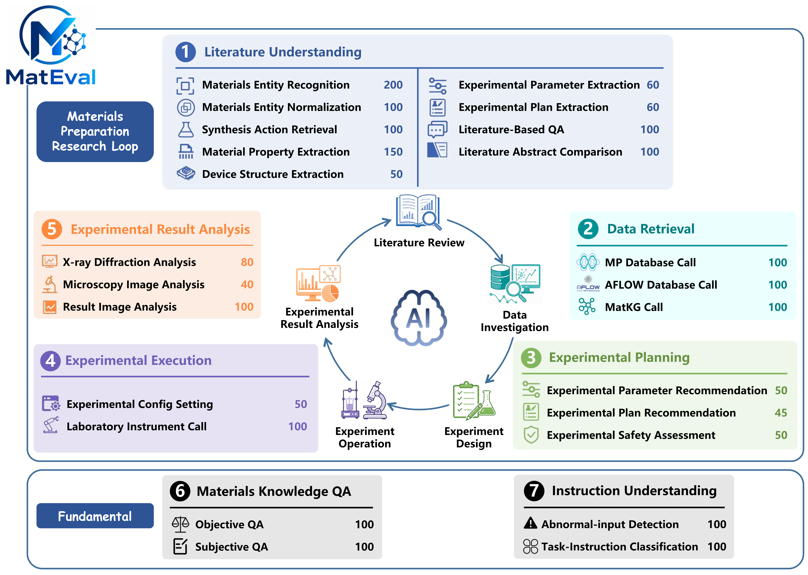

# MatEval: 评估大语言模型在材料制备研究全流程中从“知”到“行”的评测基准

<div align="center">


[](https://www.python.org/downloads/)
[](LICENSE)

[English](README.md) | [中文](README_zh.md)
</div>

## 📖 介绍

大语言模型在材料科学领域具有广阔应用前景，但现有基准尚未覆盖真实材料制备研究的完整循环。为弥补这一缺口，我们提出 MatEval，评估大语言模型从基础能力（材料知识问答与指令理解）到五个研究阶段（文献理解、数据检索、实验规划、实验执行和实验结果分析）的表现。MatEval 包含 24 项任务、共 2,135 条专家整理的样本，并采用针对各阶段的评分方案，以评估模型从“知”到“行”的能力。我们评估了 24 个大语言模型，涵盖通用模型和科学领域专用模型。结果表明，模型表现在不同研究阶段存在系统性差异，没有一个模型能在所有阶段都保持稳定表现。与通用模型相比，科学领域专用模型也未表现出稳定优势。MatEval 将评测范围从材料知识问答扩展到各研究阶段的具体产出，揭示了模型在材料制备研究全流程中表现不均衡的特点。

## ✨ 主要特性

- **全面覆盖**：24 项任务覆盖材料科研全流程，文献调研、数据调查、实验设计、实验操作、实验结果分析。
- **多模态评测**：22 项文本任务和 2 项视觉任务（显微镜图像分析、结果图像分析）。
- **多样化指标**：ACC、F1、SCORE（含 LLM 裁判评分）和 MAE，针对不同任务类型量身定制。

📝 **提交您的模型参与评测**：[MatEval 模型评测提交表单](https://forms.gle/3s4nisjc71j3J6Xc9)

## 📊 评测任务

| 序号 | 任务 | 描述 |
| :-: | :-- | :-- |
| 1  | **材料领域客观问答** | 材料领域客观知识（选择题、判断题）问答。 |
| 2  | **材料领域主观问答** | 材料领域主观知识问答。 |
| 3  | **异常输入检测** | 对输入指令进行异常检测。 |
| 4  | **任务指令分类** | 识别并分类用户指令的真实意图。 |
| 5  | **材料实体识别** | 从文本中识别材料名、材料类别、材料属性值等领域实体。 |
| 6  | **材料实体融合** | 将同一实体的多种异构表达归一化为标准名称（化学式优先原则）。 |
| 7  | **材料属性抽取** | 从文献中抽取材料属性信息。 |
| 8  | **合成动作检索** | 将动词/动词短语分类为预定义的合成操作（混合、加热、冷却等）。 |
| 9  | **器件结构抽取** | 从器件制备论文中抽取多层器件结构。 |
| 10 | **实验参数抽取** | 从文献中抽取关键实验变量（温度、配比、时间）。 |
| 11 | **实验方案抽取** | 从文献中抽取材料制备的完整操作流程。 |
| 12 | **基于文献的问答** | 基于给定文献内容回答问题。 |
| 13 | **文献摘要对比** | 对多个文献摘要进行总结并生成结构化对比表格。 |
| 14 | **MP数据库调用** | 将 Materials Project (MP) 数据库的自然语言查询语句转换为查询代码。 |
| 15 | **AFLOW数据库调用** | 将 Aflow 数据库的自然语言查询语句转换为查询代码。 |
| 16 | **MatKG知识图谱调用** | 将 MatKG 知识图谱的自然语言查询语句转换为查询代码。 |
| 17 | **实验参数推荐** | 针对用户需求推荐合适的工艺参数组。 |
| 18 | **实验方案推荐** | 针对用户需求推荐合适的实验方案。 |
| 19 | **实验安全评估** | 判断操作是否具有安全风险。 |
| 20 | **实验配置数据包设置** | 将实验操作转化为标准化配置数据包。 |
| 21 | **实验设备调用** | 根据用户需求自主选择需调用的实验设备。 |
| 22 | **X射线衍射分析** | 分析原始 XRD 文本坐标数据（2θ、强度）以识别纯相/混合相中的目标物相。 |
| 23 | **显微镜图像分析** | 分析 ReS₂ 滑移堆垛的原子级显微图像并给出滑移矢量。 |
| 24 | **结果图像分析** | 解读典型实验结果图并提炼关键信息。 |

## 🎉 评测结果

| 任务          | 数据量   | 指标        | ClaudeOpus4.8 | ClaudeOpus4.7 | GPT6Astra | GPT-5.6Sol | GPT-5.6Terra | Gemini3.8Flash | Gemini3.6Flash | Gemini3.1ProPreview | DoubaoSeed2.1Pro | Doubao-Seed-2-1-turbo | DeepSeekV4Pro0813 | DeepSeekV4Flash0731 | KimiK3 | KimiK2.6 | GLM5.3 | GLM5.3Flash | Qwen3.8Max | Qwen3.8Flash | Qwen3.8-27B | qwen3-VL-8B | Innovator-VL-8B-Instruct | MatChat | Intern-S2-397B | internvl3.5-241b-a28b |
| :---------: | :---: | :-------: | :-----------: | :-----------: | :-------: | :--------: | :----------: | :------------: | :------------: | :-----------------: | :--------------: | :-------------------: | :---------------: | :-----------------: | :----: | :------: | :----: | :---------: | :--------: | :----------: | :---------: | :---------: | :----------------------: | :-----: | :------------: | :-------------------: |
| 材料领域客观问答    | 100   | Acc.      | 71.00         | 71.00         | 77.00     | 71.00      | 69.00        | 70.00          | 65.00          | 73.00               | 69.00            | 76.00                 | 71.00             | 72.00               | 76.00  | 72.00    | 72.00  | 72.00       | 69.00      | 73.00        | 71.00       | 54.00       | 46.00                    | 66.00   | 71.00          | 64.00                 |
| 材料领域主观问答    | 100   | Score     | 52.95         | 50.11         | 62.80     | 56.89      | 55.56        | 59.60          | 50.70          | 51.65               | 55.20            | 50.93                 | 59.40             | 58.80               | 55.96  | 52.98    | 59.59  | 57.40       | 62.40      | 62.47        | 60.24       | 41.60       | 45.85                    | 51.26   | 51.00          | 51.20                 |
| 异常输入检测      | 100   | Acc.      | 99.00         | 99.00         | 97.00     | 99.00      | 98.00        | 99.00          | 99.00          | 99.00               | 96.00            | 98.00                 | 98.00             | 99.00               | 100.00 | 99.00    | 99.00  | 100.00      | 99.00      | 98.00        | 100.00      | 76.00       | 89.00                    | 98.00   | 98.00          | 96.00                 |
| 任务指令分类      | 100   | Acc       | 100.00        | 99.00         | 99.00     | 99.00      | 99.00        | 99.00          | 99.00          | 99.00               | 98.00            | 96.00                 | 98.00             | 99.00               | 99.00  | 98.00    | 100.00 | 100.00      | 99.00      | 99.00        | 100.00      | 90.00       | 82.00                    | 98.00   | 98.00          | 98.00                 |
| 材料实体识别      | 200   | F1        | 73.40         | 73.85         | 73.17     | 70.41      | 67.56        | 78.81          | 75.68          | 75.74               | 71.68            | 71.50                 | 73.28             | 73.53               | 76.35  | 74.58    | 58.53  | 72.96       | 73.60      | 73.85        | 72.93       | 64.94       | 58.41                    | 59.30   | 75.28          | 71.59                 |
| 材料实体融合      | 100   | F1        | 92.50         | 94.23         | 90.78     | 89.78      | 93.70        | 93.75          | 91.75          | 95.42               | 90.00            | 87.97                 | 93.58             | 96.58               | 92.63  | 91.47    | 94.75  | 92.75       | 95.42      | 92.17        | 91.86       | 38.07       | 18.11                    | 52.86   | 93.33          | 85.95                 |
| 合成动作检索      | 100   | F1        | 78.40         | 80.82         | 78.63     | 76.39      | 80.22        | 79.06          | 78.49          | 78.44               | 83.28            | 81.50                 | 77.70             | 78.79               | 78.68  | 83.53    | 76.16  | 78.85       | 78.75      | 77.08        | 78.44       | 76.19       | 78.58                    | 77.60   | 86.54          | 83.98                 |
| 材料属性抽取      | 150   | F1        | 81.89         | 82.22         | 78.57     | 80.54      | 81.87        | 82.84          | 84.67          | 83.83               | 83.52            | 84.82                 | 83.79             | 84.01               | 84.36  | 81.53    | 82.77  | 82.17       | 84.67      | 71.11        | 69.10       | 73.10       | 67.73                    | 77.12   | 76.44          | 79.84                 |
| 器件结构抽取      | 50    | Score     | 79.00         | 78.60         | 80.26     | 80.80      | 80.94        | 81.07          | 79.67          | 79.41               | 81.56            | 77.80                 | 82.27             | 81.86               | 83.68  | 78.98    | 84.85  | 84.07       | 80.67      | 79.93        | 80.46       | 65.60       | 53.60                    | 73.13   | 78.53          | 72.33                 |
| 实验参数抽取      | 60    | F1        | 53.46         | 45.93         | 46.60     | 43.37      | 46.11        | 36.22          | 42.52          | 54.41               | 47.53            | 46.14                 | 53.74             | 51.47               | 45.36  | 42.66    | 47.22  | 59.27       | 45.80      | 43.70        | 43.12       | 40.78       | 48.33                    | 40.03   | 51.95          | 51.78                 |
| 实验方案抽取      | 60    | F1        | 77.12         | 75.47         | 71.05     | 71.65      | 75.63        | 76.16          | 81.61          | 84.13               | 71.08            | 78.69                 | 80.63             | 78.97               | 78.90  | 78.44    | 74.36  | 73.17       | 76.57      | 73.88        | 76.31       | 66.51       | 52.01                    | 42.38   | 81.85          | 75.09                 |
| 基于文献的问答     | 100   | Score     | 61.40         | 59.00         | 78.20     | 72.00      | 72.20        | 64.60          | 54.20          | 53.20               | 59.80            | 62.60                 | 64.80             | 66.40               | 70.00  | 61.80    | 70.00  | 68.60       | 73.20      | 71.95        | 63.17       | 55.00       | 51.20                    | 63.60   | 60.60          | 62.80                 |
| 文献摘要对比      | 100   | Score     | 93.24         | 92.72         | 94.00     | 93.84      | 92.54        | 90.08          | 89.22          | 87.72               | 92.78            | 92.89                 | 92.42             | 94.36               | 91.83  | 91.59    | 90.79  | 89.69       | 92.22      | 92.99        | 92.19       | 77.69       | 75.38                    | 85.09   | 87.31          | 83.60                 |
| MP数据库调用     | 100   | Acc.      | 89.00         | 89.00         | 70.00     | 90.00      | 82.00        | 95.00          | 76.00          | 95.00               | 73.00            | 87.00                 | 47.00             | 59.00               | 67.00  | 67.00    | 51.00  | 48.00       | 87.00      | 50.00        | 48.00       | 49.00       | 20.00                    | 58.00   | 76.00          | 77.00                 |
| AFLOW数据库调用  | 100   | Acc.      | 21.00         | 17.00         | 18.00     | 8.00       | 12.00        | 21.00          | 41.00          | 20.00               | 14.00            | 16.00                 | 18.00             | 18.00               | 14.00  | 17.00    | 11.00  | 18.00       | 18.00      | 19.00        | 14.00       | 1.00        | 0.00                     | 18.00   | 17.00          | 11.00                 |
| MatKG知识图谱调用 | 100   | Acc.      | 39.00         | 36.00         | 32.00     | 27.00      | 33.00        | 66.00          | 42.00          | 48.00               | 36.00            | 23.00                 | 34.00             | 28.00               | 39.00  | 36.00    | 41.00  | 41.00       | 32.00      | 49.00        | 47.00       | 45.00       | 28.00                    | 43.00   | 39.00          | 47.00                 |
| 实验参数推荐      | 50    | LLM Score | 60.39         | 60.91         | 52.61     | 57.02      | 57.57        | 58.17          | 56.80          | 57.24               | 48.27            | 50.34                 | 55.64             | 55.46               | 56.98  | 53.98    | 52.80  | 57.42       | 56.31      | 50.48        | 49.95       | 26.34       | 35.15                    | 53.82   | 54.30          | 51.47                 |
| 实验方案推荐      | 45    | LLM Score | 97.40         | 98.53         | 95.18     | 96.78      | 93.67        | 99.29          | 99.80          | 96.09               | 97.11            | 96.40                 | 96.51             | 96.42               | 98.29  | 96.82    | 96.04  | 96.87       | 96.49      | 94.80        | 96.11       | 93.67       | 87.93                    | 99.18   | 96.16          | 97.51                 |
| 实验安全评估      | 50    | Acc.      | 94.00         | 97.92         | 90.00     | 94.00      | 90.00        | 94.00          | 92.00          | 94.00               | 92.00            | 90.00                 | 92.00             | 90.00               | 96.00  | 98.00    | 88.00  | 94.00       | 90.00      | 88.00        | 90.00       | 88.00       | 84.00                    | 95.92   | 96.00          | 92.00                 |
| 实验配置数据包设置   | 50    | Acc.      | 73.00         | 72.00         | 72.00     | 70.00      | 71.00        | 70.00          | 73.00          | 72.00               | 72.00            | 73.00                 | 72.00             | 75.00               | 72.00  | 74.00    | 74.00  | 75.00       | 73.00      | 73.00        | 74.00       | 74.00       | 76.00                    | 67.00   | 72.00          | 73.00                 |
| 实验设备调用      | 100   | Acc.      | 95.00         | 95.00         | 95.00     | 95.00      | 94.00        | 96.00          | 95.00          | 95.00               | 95.00            | 93.00                 | 93.00             | 90.00               | 92.00  | 97.00    | 93.00  | 96.00       | 94.00      | 95.00        | 92.00       | 84.00       | 79.00                    | 88.00   | 95.00          | 95.00                 |
| X射线衍射分析     | 80    | Acc.      | 68.75         | 66.25         | 70.00     | 72.50      | 71.25        | 75.00          | 70.00          | 68.75               | 78.75            | 73.75                 | 72.50             | 76.25               | 76.25  | 74.68    | 83.75  | 72.50       | 76.25      | 75.00        | 75.00       | 38.75       | 70.00                    | 66.25   | 67.50          | 38.75                 |
| 显微镜图像分析     | 40    | MAE       | 2.88          | 2.76          | 2.78      | 3.06       | 2.92         | 3.11           | 2.82           | 2.75                | 2.91             | 2.93                  | —                 | —                   | 2.93   | 2.91     | —      | 2.90        | 2.76       | 2.74         | 3.02        | 2.90        | 2.25                     | 2.92    | —              | 2.95                  |
| 结果图像分析      | 100   | LLM Score | 70.69         | 72.51         | 72.34     | 72.48      | 71.58        | 71.48          | 71.11          | 74.12               | 64.55            | 68.92                 | —                 | —                   | 74.79  | 72.29    | —      | 68.38       | 71.11      | 61.97        | 63.25       | 59.96       | 51.35                    | ×       | —              | 65.96                 |

## 🚀 快速开始

### 安装

```bash
# Python 3.10+
pip install -r requirements.txt           # 核心依赖（全部 24 项任务）
pip install -r requirements-vision.txt     # 可选：其他视觉任务依赖
```

### 计算 Metric

```bash
# 为所有 24 项任务 × 全部模型计算 metric
python calculator.py --data-dir data --output-dir results
```

输出（写入 `--output-dir`，默认 `results/`）：

- `<task>__<model>__scores.jsonl` — 每个 (任务, 模型) 对的逐条评分
- `summary.json` — 每个 (任务, 模型) 的聚合 metric
- `summary.xlsx` — 透视表（模型 × 任务）

> `results/` 不随仓库分发，已由 `.gitignore` 排除，由 `calculator.py` 首次运行时重新生成。


## 📄 许可证

本项目采用 Apache License 2.0 开源协议。详见 [LICENSE](LICENSE)。


